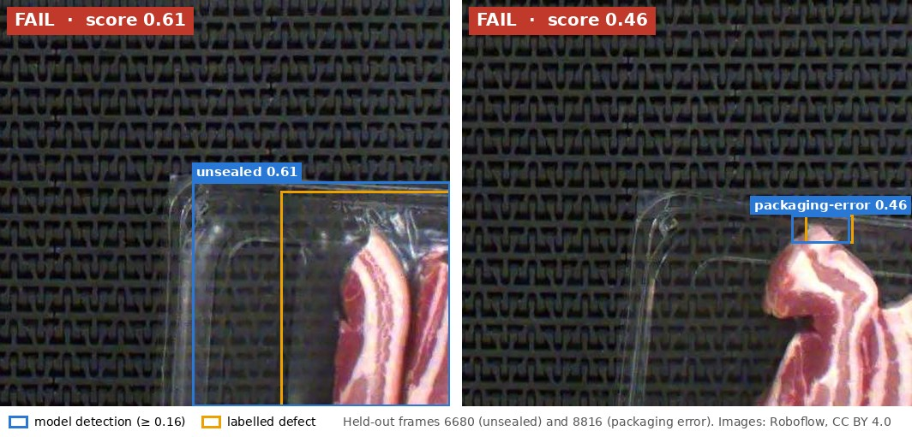

# Pork-Rasher Packaging Inspection

**Computer-vision quality inspection for a meat-packaging line, with a validated, real-time evaluation.**

[](https://github.com/Hudson11111/MMA3001Project/actions/workflows/ci.yml)

[](LICENSE)
[](https://docs.astral.sh/ruff/)
[](https://colab.research.google.com/github/Hudson11111/MMA3001Project/blob/main/notebooks/00_colab_setup_and_first_look.ipynb)

MMA3001 Numerical Methods and Machine Learning · Individual project · Monash University, 2026 · Hudson



Bacon rashers are packed in film-sealed trays that pass under an overhead camera. This project
detects packaging defects in a single camera frame, turns the detections into a **FAIL / REVIEW /
PASS** decision for the tray, and tests whether the method is accurate, robust and fast enough
for a line running at 120 trays per minute.

## Key results

| Question | Answer | Where |
|---|---|---|
| Can the dataset's own split be trusted? | **No.** Its splits interleave neighbouring video frames; scored on identical images, this inflates mAP50 by **+0.27** (95% CI +0.06 to +0.35). All results use a time-blocked re-split. | Report §2, §4.2 |
| How accurate is the detector on held-out data? | One-shot TEST: headline AP50 **0.748** (CI 0.68–0.84); unsealed **0.91**, packaging-error **0.58** | Report §4.3 |
| How good are the tray decisions? | **1 miss in 156** defective trays; 94% of automatic FAILs are correct. Thresholds were frozen before TEST. | Report §4.4 |
| Is deep learning needed? | The detector outranks a decision tree, an SVM and an MLP on hand-crafted features for every target, most clearly on small defects | Report §5.2 |
| Is it fast enough? | p95 **16.6 ms** per image end to end on a T4 GPU and an 82 ms forward pass on one CPU thread, against a 250 ms budget. Batch-1 latency is limited by per-layer overhead, not FLOPs. | Report §5.3 |
| Does the integration rule for AP matter? | Rules that are O(h²) or O(h⁴) on smooth integrands fall to about O(h) on the step-shaped precision envelope, and Romberg fails, but the spread between rules is 17× smaller than the bootstrap CI | Report §5.4 |

**Main limitation:** the data contain almost no fully visible good trays, so PASS accuracy and the
false-reject rate on a real line are not yet validated (report §6).

## Quick start

```bash
git clone https://github.com/Hudson11111/MMA3001Project.git
cd MMA3001Project
python -m venv .venv && source .venv/bin/activate

pip install -e ".[detector]"                 # package + Ultralytics (CPU is fine)
porkqc path/to/frame.jpg                     # -> FAIL / REVIEW / PASS, score, top detections
```

The committed model (`models/yolo11n_640_blocked.pt`, see its [model card](models/README.md)) and
the frozen thresholds (`configs/decision.yaml`) are used by default.

Run the tests and rebuild the documentation:

```bash
pip install -e ".[dev,analysis]"
bash scripts/run_tests.sh                    # pytest + coverage -> reports/test_report.html
bash scripts/build_docs.sh                   # pdoc -> docs/api/index.html
ruff check src tests                         # lint
```

## Documentation

| Document | Contents |
|---|---|
| [Written report](docs/REPORT.md) | Snapshot of the submitted report |
| [API documentation](https://htmlpreview.github.io/?https://github.com/Hudson11111/MMA3001Project/blob/main/docs/api/index.html) | HTML generated by pdoc from NumPy-style docstrings ([source](docs/api/index.html)) |
| [Test report](https://htmlpreview.github.io/?https://github.com/Hudson11111/MMA3001Project/blob/main/reports/test_report.html) | pytest-html: 249 tests, 95% line coverage ([source](reports/test_report.html)) |
| [Input/output specification](docs/IO_SPECIFICATION.md) | Formats, units, domains and handling of invalid input |
| [Results log](docs/RESULTS_LOG.md) | Every reported number, with its source file |
| [Decision log](docs/DECISION_LOG.md) | Why each choice was made, and by whom |
| [Verification log](docs/VERIFICATION_LOG.md) | How correctness was checked; every bug found and fixed |
| [AI usage log](docs/AI_USAGE_LOG.md) | Disclosure of AI assistance, session by session |
| [Learning objectives map](docs/LEARNING_OBJECTIVES_MAP.md) | Which unit learning objectives the project evidences |
| [Project plan](docs/PROJECT_PLAN.md) | The original plan (12 Oct), with a plan-versus-actual summary |

## Repository structure

```
MMA3001Project/
├── src/porkqc/          Python package: all reusable code, NumPy-style docstrings
│   ├── data/            download, label validation, audit, copy detection, time-blocked re-split
│   ├── metrics/         IoU, matching, average precision, quadrature, evaluation and bootstrap
│   ├── models/          YOLO wrapper (train / resume / predict) and scikit-learn baseline
│   ├── decision.py      FAIL / REVIEW / PASS rule and cost-based threshold search
│   ├── perf.py          FLOP counting, arithmetic intensity, machine balance, timing
│   ├── robustness.py    controlled image perturbations
│   └── cli.py           command line: image(s) -> detections and decision
├── tests/               pytest suite: unit, regression and verification-against-library tests
├── notebooks/           00–04 run on Colab; 05–06 run on CPU and are committed with outputs
├── configs/             dataset and split, training runs, frozen decision thresholds
├── models/              selected trained model and model card
├── results/             every prediction, metric and figure behind the report (JSON / CSV / PNG)
├── docs/                report, logs, I/O specification, HTML API documentation
├── reports/             HTML test report
└── scripts/             run_tests.sh, build_docs.sh
```

## Reproducing the results

All predictions are committed in `results/`, so every table and figure in the report can be
regenerated on a CPU without the dataset or a GPU (notebooks 05–06). The full pipeline runs on
Google Colab's free tier:

| | Notebook | Runtime | Produces |
|---|---|---|---|
| 0 | [`00_colab_setup_and_first_look`](https://colab.research.google.com/github/Hudson11111/MMA3001Project/blob/main/notebooks/00_colab_setup_and_first_look.ipynb) | Colab CPU | dataset download check, class counts, development sample |
| 1 | [`01_data_audit`](https://colab.research.google.com/github/Hudson11111/MMA3001Project/blob/main/notebooks/01_data_audit.ipynb) | Colab CPU | leakage audit, scene detection, unlabelled-image review, time-blocked split |
| 2 | [`02_train_detector`](https://colab.research.google.com/github/Hudson11111/MMA3001Project/blob/main/notebooks/02_train_detector.ipynb) | Colab T4 | three training runs, curves, validation predictions |
| 3 | [`03_cross_evaluate`](https://colab.research.google.com/github/Hudson11111/MMA3001Project/blob/main/notebooks/03_cross_evaluate.ipynb) | Colab T4 | every model on identical images (leakage measurement) |
| 4 | [`04_test_performance_robustness`](https://colab.research.google.com/github/Hudson11111/MMA3001Project/blob/main/notebooks/04_test_performance_robustness.ipynb) | Colab T4 | one-shot TEST, latency and FLOPs, resolution and FP16, robustness, baseline features |
| 5 | [`05_ap_as_integral`](notebooks/05_ap_as_integral.ipynb) | CPU, < 1 min | numerical-integration study |
| 6 | [`06_final_analysis`](notebooks/06_final_analysis.ipynb) | CPU, ~2 min | TEST metrics, decisions, baseline, roofline, robustness, failure modes |

**One-time Colab setup**

1. Create a free account at [roboflow.com](https://roboflow.com) and copy your private API key
   (Settings → API Keys).
2. In Colab, open the key icon and add a secret named `ROBOFLOW_API_KEY` with *Notebook access*
   enabled. Never paste keys into cells.
3. For notebooks 02–04, choose *Runtime → Change runtime type → T4 GPU*.

Each Colab run records its library versions, GPU and git commit next to its results.

**Environment**

| Where | Python | Key packages |
|---|---|---|
| Colab (GPU work) | 3.13 | `ultralytics==8.4.175`, `roboflow==1.7.1` ([`requirements-colab.txt`](requirements-colab.txt)); PyTorch and CUDA as provided by Colab |
| Local and CI | ≥ 3.10 | `pyproject.toml` extras: `detector`, `dev`, `analysis`, `data` |

## Data

[*Pork Rasher Error (Packaging)*](https://universe.roboflow.com/hello-2aqe0/pork-rasher-error-packaging/dataset/4),
version 4, Roboflow Universe workspace `hello-2aqe0`, licensed
[CC BY 4.0](https://creativecommons.org/licenses/by/4.0/). It contains 3,349 / 120 / 80 images at
720 × 540 px, with boxes for loose-meat, packaging-error, twisted-meat, unsealed and wrinkle. The
dataset is downloaded at run time and is not redistributed here, apart from the two cropped,
annotated frames in `docs/assets/demo.jpg`.

## AI use

AI assistance (Claude, Anthropic) was used throughout and is disclosed in the
[AI usage log](docs/AI_USAGE_LOG.md) and the report. Commits written by the assistant are authored
"Claude"; every change reached `main` through a pull request that I reviewed and merged. Errors
made by the AI and caught during the project are recorded in the
[verification log](docs/VERIFICATION_LOG.md).

## Citation

If you use this work, please cite it using the metadata in [`CITATION.cff`](CITATION.cff)
(GitHub's *Cite this repository* button).

## Licence

Code © 2026 Hudson, released under the [GNU AGPL-3.0](LICENSE), chosen for compatibility with
Ultralytics YOLO (AGPL-3.0), which this project uses. The dataset is licensed separately under
CC BY 4.0.
