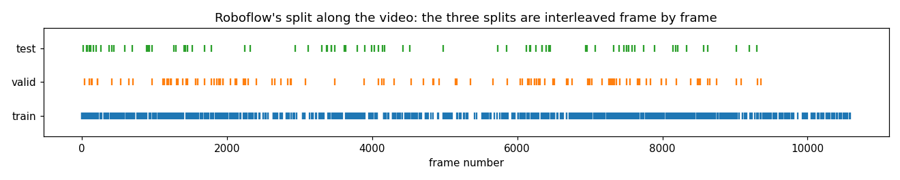
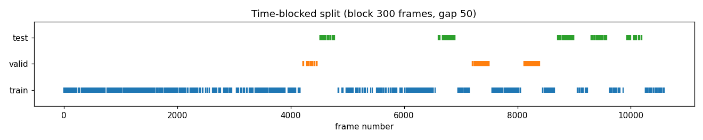
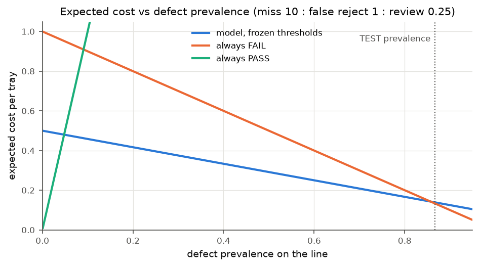
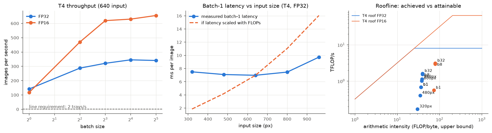
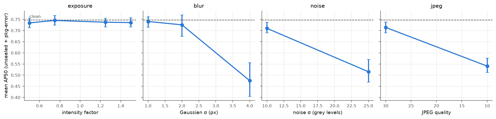
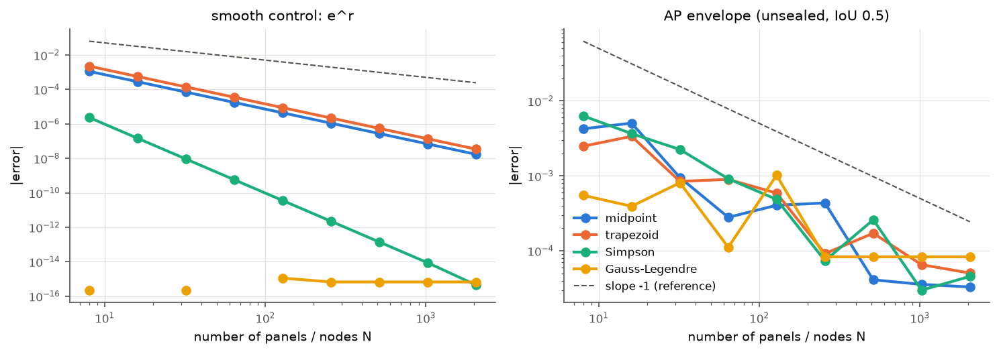

> **Snapshot of the written report** (17 Oct 2026). The editable master is a shared document exported to Word/PDF for Moodle; this copy keeps the report under version control next to the evidence it cites. Section 7 is written by Hudson.

# Automated Inspection of Pork-Rasher Packaging

2026-10-17 · Hudson

MMA3001 Numerical Methods and Machine Learning — Individual Project.
Repository:
[github.com/Hudson11111/MMA3001Project](https://github.com/Hudson11111/MMA3001Project)

## Summary

A fine-tuned YOLO11n detector sorts conveyor images of trays into FAIL,
REVIEW or PASS. Tested once on held-out data, it reaches a headline AP50
of **0.748** (95% CI 0.68–0.84), misses 1 of 156 defective trays, and
runs at a p95 of 16.6 ms against a 250 ms budget. The dataset's own
split leaks neighbouring video frames, inflating mAP50 by **+0.27**, so
a time-blocked split is used throughout. PASS accuracy cannot yet be
validated, because the data contain almost no fully visible good trays.

## 1. Engineering problem

**Context and problem.** Bacon rashers are packed into film-sealed trays
that pass under an overhead camera. Several kinds of defect must be
removed before distribution: unsealed or lifted film, loose or twisted
rashers, wrinkled film and other packaging errors. Manual inspection of
a fast line is tiring and inconsistent.

Given one 720 × 540 RGB frame, the system must detect and localise five
defect types and decide FAIL (reject), REVIEW (send to an inspector) or
PASS. It must also be shown to be accurate and fast enough for in-line
use.

**Why it matters and intended use.** A missed unsealed pack spoils and
can cause a recall, whereas a false reject only costs re-work. The
system is therefore decision support. It removes clear defects and
routes uncertain trays to a person, showing where each defect is so the
person can check it.

**Requirements.** No line speed was given, so the requirements below
were derived from published equipment speeds (decision D-007):

| \#  | Requirement         | Value and basis                                                                                        |
|-----|---------------------|--------------------------------------------------------------------------------------------------------|
| R1  | Throughput          | 120 trays/min, which exceeds a bacon tray line (24/min \[2\]) and a fast tray sealer (\> 90/min \[3\]) |
| R2  | Latency, end to end | ≤ 250 ms per image: half the tray interval, leaving time for capture and rejection                     |
| R3  | Error costs         | miss : false reject : review = 10 : 1 : 0.25, assumed and tested for sensitivity                       |

**Scope limits.** Three things are excluded: meat quality (the data has
no ground truth for it), seal strength (it is not visible in an image),
and other lines or cameras. Speed was measured on a cloud T4 GPU and a
CPU, not on line hardware, and each frame is judged on its own.

## 2. Inputs, outputs and data

| Item                   | Format, units and domain                                                                                                                                         | Meaning and use                                                             |
|------------------------|------------------------------------------------------------------------------------------------------------------------------------------------------------------|-----------------------------------------------------------------------------|
| **Input:** image       | JPEG/PNG or array `(H, W, 3)`, `uint8` RGB; pixel coordinates. Validated domain: 720 × 540 px from this line's camera and lighting, within the tolerances in 5.5 | One view of the conveyor; a tray may be only partly visible                 |
| **Output:** detections | `[class, confidence, x1, y1, x2, y2]` per box; confidence in \[0, 1\]; pixels of the original image                                                              | Where each suspected defect is: for operators and for evaluation            |
| **Output:** decision   | `FAIL` / `REVIEW` / `PASS` from the top confidence (FAIL ≥ 0.16, REVIEW ≥ 0.01)                                                                                  | Reject, send to an inspector, or “no defect found” (not a validated “good”) |
| **Output:** timing     | ms per stage, per image                                                                                                                                          | Checked against R2                                                          |

**Function-level inputs and outputs** are given in NumPy-style
docstrings, rendered as HTML by pdoc. The model runs from the command
line with `python -m porkqc.cli frame.jpg`.

**Invalid input** is rejected with a specific error rather than
processed silently. This covers missing files, non-images, wrong array
shapes, malformed labels (reported with file and line), mismatched
classes or image sizes, and invalid thresholds. Each case has a test
(Appendix C). Images from other cameras are processed but unvalidated.

**Data.** The dataset is Roboflow *Pork Rasher Error (Packaging)*,
version 4 \[1\], licensed CC BY 4.0. It has 3,349 / 120 / 80 train /
validation / test images, with boxes for five classes. My audit
(notebook 01) found four problems:

1.  **The splits interleave consecutive video frames** (Figure 1). A tray
    stays in view for 5–15 frames, yet validation and test frames lie a
    median of 3 frames from a training frame. This is temporal leakage
    \[13, 14\].

2.  **File names are not unique: 128 are shared by different images.**
    Augmented copies were therefore identified by thumbnail correlation,
    calibrated with positive and negative controls, which revealed 1,211
    distinct training scenes. Perceptual hashing failed on the dark
    background and was dropped.

3.  **The classes are imbalanced.** Box counts are packaging-error
    1,769, unsealed 1,185, twisted-meat 79, loose-meat 72 and
    wrinkle 18. Packaging-error boxes are tiny, with a median of 0.37%
    of the image.

4.  **“No label” does not mean “good tray”.** A coded review of the 26
    unlabelled test and validation frames found 25 partial trays and 1
    missed defect.

**Split used for all results (D-008).** Blocks of 300 frames were
assigned whole to train, validation or test (70/15/15%), and a 50-frame
gap between splits was discarded. This gave 938 / 196 / 180 scenes, none
within 50 frames of training. Validation and test then come from only a
few stretches of video, so uncertainty is estimated by resampling
50-frame runs.




*Figure 1. Frame positions of each split: the provided random split
(top) and the time-blocked split (bottom).*

## 3. Computational approach

### 3.1 Detector: YOLO11n with transfer learning

**How it works.** YOLO11n \[4\] is a one-stage convolutional neural
network with 2.6 M parameters, costing 4.8 GFLOP per 640 × 480 image.
Convolution layers extract features at strides of 8, 16 and 32 px. At
every location, a head predicts class probabilities and the distances to
the four sides of a box, and non-maximum suppression (IoU 0.7) removes
duplicates. Training minimises box, classification and
distribution-focal losses by mini-batch gradient descent, the same
iterative fitting as an MLP.

**Why it was chosen.** Operators need to see where a defect is. A
one-stage “nano” model meets the latency budget even on a CPU. About
1,000 training scenes are too few to learn features from scratch, so
COCO-pretrained weights are fine-tuned (transfer learning). Each run
also fits within a free Colab T4 session.

**Assumptions.** The method assumes four things:

1.  the line matches the dataset's camera, lighting and products;

2.  labels are complete for fully visible defects;

3.  frames more than 50 apart are independent;

4.  features learned on COCO transfer to film-covered trays.

**Settings (D-017).** Every run used the same settings: 640 px input,
batch 16, at most 50 epochs, and early stopping with patience 15 on
validation fitness (0.1 · mAP50 + 0.9 · mAP50-95). Seed 0 was set in
deterministic mode with mixed precision, and the library's default
optimiser and augmentation were kept (Ultralytics 8.4.175, pinned).

The selected run stopped at epoch 43, with its best epoch at 28, after
22.6 min on a T4. Training box loss fell from 1.80 to 1.07 while
validation loss stayed near 1.7. The leaky split had hidden this
generalisation gap.

**Limitations.** A typical packaging-error box is only about 20 px wide
at 640 px. The rare classes are too scarce to learn or to evaluate
(D-024). Validation mAP50 jumps by ±0.1 between epochs, so choosing the
best epoch makes the validation score look better than it is.

### 3.2 Decision layer

The image score *s* is the highest box confidence. A tray is FAIL if *s*
≥ *t*\_fail, REVIEW if *s* ≥ *t*\_review, and PASS otherwise.

The two thresholds minimise the expected cost per validation image (miss
10, false reject 1, review 0.25). Cost is a step function of the
thresholds, so there is no gradient to follow. An exhaustive search over
all 5,151 pairs at 0.01 resolution is therefore exact.

The search gave *t*\_review = 0.01 and *t*\_fail = 0.16. Both were
**committed before any test prediction existed** (pre-registration,
D-026).

### 3.3 Evaluation pipeline and implementation

Predictions are exported once and scored by my own tested package
`porkqc.metrics`. Matches are taken in confidence order at IoU ≥ 0.5 for
AP50 and at 0.50–0.95 for mAP50-95. AP is the area under the precision
envelope \[6\]:

``` latex
\mathrm{AP}=\int_0^1 p_{\mathrm{interp}}(r)\,dr,\qquad p_{\mathrm{interp}}(r)=\max_{k:\,r_k\ge r} p_k
```

The envelope is a monotone, shape-preserving interpolant and a step
function, so it is integrated exactly; the alternative quadrature rules
are compared in 5.4. 95% CIs come from a percentile bootstrap over
50-frame runs (1,000 resamples) \[10\]. Model differences use a paired
bootstrap on identical images.

**Implementation.** The package `porkqc` holds all the code. It has pdoc
HTML documentation, 249 tests with 95% coverage, and CI. Notebooks run
either in Colab or on CPU from the committed results (Appendix A).

## 4. Validation method and results

### 4.1 What was validated, how, and against which criteria

| What             | Method                                                                             | Criterion                                  | Result                                                                                                       |
|------------------|------------------------------------------------------------------------------------|--------------------------------------------|--------------------------------------------------------------------------------------------------------------|
| Code correctness | Hand-computed answers; manufactured controls; comparison with Ultralytics and THOP | Exact agreement                            | Metrics match Ultralytics to 10⁻⁹; FLOPs within 1%; a CPU re-run reproduces the GPU predictions (Appendix D) |
| Split validity   | Frame gaps between splits; scene detection with controls                           | No test frame within 50 frames of training | Provided split fails (100%); blocked split passes (0%)                                                       |
| Accuracy         | Withheld TEST set (180 images, 30 runs), used once                                 | AP50 with CI; must beat the baselines      | 0.748 (0.68–0.84); beats all baselines (5.2)                                                                 |
| Decisions        | Frozen thresholds on TEST                                                          | Misses; cost against trivial rules         | 1 miss in 156 (4.4)                                                                                          |
| Speed            | Synchronised timing; profiler                                                      | R2, ≤ 250 ms                               | 16.6 ms (T4, p95); 82 ms forward pass on one CPU thread                                                                               |

**Why these methods are appropriate.** Neighbouring frames are
near-identical, so a held-out set is meaningful only if separated in
time \[13\], and uncertainty must resample runs rather than frames. On
validation, a frame bootstrap gives a CI of 0.54–0.71, against an honest
0.51–0.79 from resampling runs.

An early comparison scored on different validation sets pointed the
wrong way (V12), so all comparisons use identical images. All 19 issues
found in verification are covered by regression tests.

### 4.2 Leakage measured on identical images

| YOLO11n on blocked validation   | mAP50                    | mAP50-95                 | AP50 unsealed        | AP50 packaging-error |
|---------------------------------|--------------------------|--------------------------|----------------------|----------------------|
| Trained on the provided split   | 0.878                    | 0.609                    | 0.906                | 0.835                |
| Trained on the blocked split    | 0.609                    | 0.335                    | 0.807                | 0.687                |
| **Difference** (95% CI, paired) | **+0.27** (+0.06, +0.35) | **+0.27** (+0.13, +0.34) | +0.10 (+0.03, +0.18) | +0.15 (+0.08, +0.21) |

### 4.3 One-shot TEST results

| Metric                                     | Validation (used for every choice) | **TEST** (used once), 95% CI |
|--------------------------------------------|------------------------------------|------------------------------|
| Headline AP50 (unsealed + packaging-error) | 0.747                              | **0.748** (0.680–0.838)      |
| AP50 unsealed (47 boxes)                   | 0.807                              | **0.912** (0.830–0.991)      |
| AP50 packaging-error (126 boxes)           | 0.687                              | **0.585** (0.477–0.725)      |
| mAP50 / mAP50-95, all labelled classes     | 0.609 / 0.335                      | 0.753 / 0.480                |

The headline metric transfers almost exactly from validation to TEST.
The all-class figures move only because two classes have 1–2 test boxes
each (D-024).

### 4.4 Tray decisions

| TEST policy              | Misses (of 156) | False rejects (of 24) | Reviews | Cost per image |
|--------------------------|-----------------|-----------------------|---------|----------------|
| Model, frozen thresholds | **1**           | 9                     | 24      | 0.139          |
| Always FAIL              | 0               | 24                    | 0       | 0.133          |
| Always PASS              | 156             | 0                     | 0       | 8.667          |

Of the trays the model sends to FAIL, 94% are truly defective. But TEST
is 87% defective, so rejecting everything is marginally cheaper there.

Figure 2 shows the cost across prevalence. The model wins below 86%
prevalence. At a realistic 1–5%, however, its 37.5% false-reject rate
makes always-PASS as cheap, so the thresholds must be re-fitted at the
line's real prevalence.



*Figure 2. Expected cost per tray against defect prevalence, at the
error rates measured on TEST.*

### 4.5 Failure modes

- **Small boxes.** Recall at the FAIL threshold is 0.53 for
  packaging-error boxes under 0.26% of the image, against 0.95 for large
  unsealed areas.

- **Localisation.** Of 94 false positives, 57 have the right class but
  IoU 0.1–0.5. Only 1 has the wrong class.

- **IoU sensitivity.** IoU is numerically fragile for tiny boxes. A 3 px
  diagonal shift of a 20 px box gives IoU 0.57, and a 4 px shift gives
  0.47, so near-misses an operator would accept count as errors.

### 4.6 Influence on selection, and what validation cannot establish

Validation decided the stopping epoch, the choice of YOLO11n over
YOLO26n (D-025, my decision), the thresholds and the baseline
hyper-parameters. Its scores are therefore optimistic, and only TEST is
unbiased. Nothing was tuned after TEST.

Validation **cannot establish** six things:

- PASS accuracy on real good trays, which are almost absent from the
  data;

- performance on the rare classes;

- performance on other lines, cameras or days, since validation and test
  come from 18 and 30 runs of the same footage;

- seal strength;

- whether the cost ratios are right;

- latency on line hardware.

## 5. Comparison and optimisation

Speed has a 15× margin on a T4 (3× on one CPU thread), so accuracy
decided every trade-off. Appendix E compares all approaches on the
brief's eight criteria.

### 5.1 Alternative detector: YOLO26n

YOLO26n \[5\] is a newer model with an optional NMS-free head. It was
trained with identical settings and compared on identical images with a
paired bootstrap.

Its mAP50 was +0.13 higher (CI −0.08 to +0.27), which is not significant
and comes from classes with only 3–4 boxes. On unsealed it was +0.02
(not significant). On packaging-error, the most frequent defect, it was
**significantly worse**: −0.08 (−0.13 to −0.01). Latency was equal
within noise.

I therefore chose YOLO11n (D-025).

### 5.2 Classical baseline vs detector

The classical baseline is a set of scikit-learn \[11\] classifiers on
324 hand-crafted features: a colour histogram, a 16 × 12 thumbnail and
four edge statistics. Each classifier was tuned on validation. The
detector competes on the same image-level question, using its highest
box confidence as the image score.

| TEST image-level AP | Tree  | SVM   | MLP   | **YOLO11n** (95% CI)    | No-skill |
|---------------------|-------|-------|-------|-------------------------|----------|
| Any defect          | 0.903 | 0.941 | 0.959 | **0.980** (0.957–0.994) | 0.867    |
| Unsealed            | 0.807 | 0.937 | 0.953 | **0.973** (0.930–0.999) | 0.261    |
| Packaging-error     | 0.841 | 0.924 | 0.914 | **0.971** (0.946–0.991) | 0.611    |

The baseline is respectable: about 25 ms per image on one CPU core, and
under 2 s to train. It would make a cheap “defect somewhere” alarm.
However, it falls below the detector's CI on small packaging-error
defects, and it cannot show where a defect is.

### 5.3 Runtime, FLOPs and arithmetic intensity

**Method.** Latency is the median and p95 of 100 synchronised runs,
after 20 warm-up runs. FLOPs are counted by hooks on all 88
convolutions, with F = 2 · (Cᵢₙ/g) · k² · Cₒᵤₜ · H · W. Bytes are
weights plus activations, so the intensity is an upper bound. GPU time
is broken down with PyTorch's profiler \[12\].

**Roofline \[9\].** The T4's machine balance is 8.1 TFLOP/s ÷ 320 GB/s =
25 FLOP/byte in FP32 \[8\], or 27 with the datasheet's 300 GB/s. The
model's intensity is about 37 FLOP/byte, so it is compute-bound in
principle. In FP16 the balance rises to 203 FLOP/byte and most layers
become memory-bound.

**What limits speed at batch 1 is neither FLOPs nor either roof.** From
320 to 800 px the FLOPs grow 6×, yet latency stays at 7.0–7.5 ms (Figure
3, middle). The achieved 0.17–1.1 TFLOP/s is far below both roofs
(Figure 3, right). Fixed per-layer overhead, such as launching 88 small
kernels, dominates instead; the profiler attributes 75% of GPU time to
convolutions.

**Batching and precision.** Batching with FP16 raises throughput from
142 to 655 images/s. At batch 1, however, FP16 is slower (8.5 vs 7.1
ms), and the line needs only 2 images/s.



*Figure 3. Throughput against batch size (left); batch-1 latency against
input size (middle); the roofline (right).*

| Input size (validation, paired) | 320    | 480           | **640** | 800    | 960    | 640 FP16 |
|---------------------------------|--------|---------------|---------|--------|--------|----------|
| Δ headline AP50 vs 640 FP32     | −0.135 | −0.030 (n.s.) | 0       | −0.035 | −0.074 | −0.002   |

Accuracy peaks at the training resolution: smaller inputs lose tiny
boxes, and larger ones show objects at an unfamiliar scale. Shrinking
the input saves no time. The final design is therefore **640 px, FP32,
batch 1**, with a p95 of 16.6 ms on TEST.

### 5.4 Average precision as a numerical integral

Benchmarks approximate the AP integral with different rules, so I
treated the choice as a quadrature problem (notebook 05; Appendix F,
Figure A2).

On a smooth control (eʳ), midpoint, trapezoid and Simpson show their
textbook orders of 2, 2 and 4, which verifies the implementations
\[15\]. On the AP envelope every rule drops to about first order (*p* =
0.79–0.99), because the panel containing each jump contributes an O(*h*)
error. Gauss–Legendre gains nothing, and Romberg fails: it assumes
successive error ratios of 4, but the observed ratios range from 0.5 to
10.7.

The spread between rules is 0.017 mAP50, mostly from VOC's 11-point
rule. That is 17× smaller than the bootstrap CI width of 0.30, so the
data, not the quadrature, limit the result. The exact rule is used
because it removes discretisation error entirely.

### 5.5 Robustness, sensitivity, and original vs final

Exposure changes of ±50% have no significant effect. Mild degradation
(blur σ ≤ 2 px, noise σ 10, JPEG quality 30) costs at most 0.04 AP50.

Strong degradation costs 0.21–0.27, almost all of it on packaging-error
(Figure A1), so the camera needs short exposures and no lossy
compression. Across miss costs of 3–50, the optimal thresholds still
give zero misses on validation.

| Aspect         | Original (run 1)                      | Final                                    | Evidence                              |
|----------------|---------------------------------------|------------------------------------------|---------------------------------------|
| Split          | Provided random split                 | Time-blocked                             | Removes +0.27 optimism (4.2)          |
| Reported score | mAP50 0.66 from the library's `val()` | AP50 0.748 on a once-used TEST, with CI  | `val()` overstated by 0.03–0.11 (V11) |
| Output         | Boxes                                 | Boxes plus cost-optimal FAIL/REVIEW/PASS | 4.4                                   |
| Settings       | Library defaults                      | 640 px, FP32, batch 1, measured          | 5.3                                   |

## 6. Limitations and lessons learned

The system detects unsealed packs reliably and is fast enough for any
realistic line, but it is not yet a validated accept/reject machine. The
table below gives each remaining limit with a proposed improvement.

| Limitation                                                                | Proposed improvement and justification                                                                                                            |
|---------------------------------------------------------------------------|---------------------------------------------------------------------------------------------------------------------------------------------------|
| Almost no good trays in the data, so PASS accuracy is unknown             | Record normal production and re-fit the thresholds at the line's prevalence: below about 5%, the frozen thresholds lose to always-PASS (Figure 2) |
| Frames are judged singly, although each tray appears in 5–15 frames       | Trigger on “tray fully in view”, or aggregate each tray's frames. This reduces both misses and edge-frame alarms                                  |
| Small packaging-error defects (recall 0.53); IoU penalises 3–4 px offsets | Crop or tile the tray and *retrain* at that scale, because the current model run at 800–960 px did not help. Also report a size-aware match       |
| Rare classes; small, correlated test sets; one camera                     | Collect video across days and shifts, then pilot the command-line tool on the line, logging operator overrides as new labels                      |

**Lessons learned.**

1.  **Audit the data before trusting a score.** Training straight away
    would have produced a convincing mAP50 of 0.66, on a split that inflates scores by about 0.27.

2.  **Calibrate methods on real data, compare on identical data, and
    resample the independent unit.** Hashing worked on synthetic tests
    and failed on real frames. Mismatched validation sets reversed an
    early conclusion, and frame-level bootstraps were too narrow.

3.  **Check a numerical method's assumptions.** Simpson's and Romberg's
    error estimates need a smooth integrand, and FLOPs do not predict
    latency at batch 1. Measuring the observed order and the latency
    curve exposed both.

4.  **Pre-register what you can.** Freezing the model and thresholds
    before testing makes the agreement between validation and TEST
    (0.747 vs 0.748) evidence rather than tuning.

## 7. AI use and reflection

*\[Hudson to write in his own words. The eight headings below are the points the brief requires. Aim for about 300 words to keep Sections 1–7 within 10 pages. Delete this note and the evidence list at the
end when done.\]*

**Which AI tools were used.** \[ \]

**What they were used for.** \[ \]

**Approximate level of AI contribution.** \[ \]

**Why AI was used for those tasks.** \[ \]

**How AI-generated material was checked.** \[ \]

**Which important decisions remained my responsibility.** \[ \]

**Errors, limitations or unhelpful suggestions produced by AI.** \[ \]

**How AI use affected my understanding and workflow.** \[ \]

*Evidence available in the repository (delete before submission):*

- `docs/AI_USAGE_LOG.md` has one row per session (sessions 1–8); the
  “Your verification” column still needs filling.

- `docs/DECISION_LOG.md` gives the provenance of each decision. Yours
  include the framing, the licence, the unlabelled-frame review (25 E /
  1 M), re-coding the two G frames as E, and choosing YOLO11n for TEST
  (D-025).

- `docs/VERIFICATION_LOG.md` lists errors in AI-written code or plans
  that were caught. Those caught on real data or in CI include V1 (an
  ignore rule hid a code folder from the repository), V3 (a finished run
  would have been silently retrained), V8 (a local dry run pushed fake
  results to your repository), V9 (the download bug you found in Colab)
  and V10 (the planned hashing method failed on real images). Those
  found in Claude's own tests include V12 (a confounded run comparison),
  V15 (wrong expected values in two unit tests) and V19 (a test-order
  bug).

- The pull-request history (PRs \#1–#14) shows each change reviewed and
  merged by you.

## 8. References

1.  hello-2aqe0 (Roboflow Universe workspace), *Pork Rasher Error
    (Packaging)*, version 4, object-detection dataset, CC BY 4.0.
    [universe.roboflow.com/hello-2aqe0/pork-rasher-error-packaging](https://universe.roboflow.com/hello-2aqe0/pork-rasher-error-packaging).
    Accessed 12 Oct 2026.

2.  Pearson Packaging Systems, *Complete Line for Trays and Bags of
    Bacon* (“up to 24 products per minute for trays”).
    [pearsonpkg.com](https://pearsonpkg.com/integrated-systems/case-packing-for-trays-and-bags-of-bacon/).
    Accessed 17 Oct 2026.

3.  Food Processing (Australia), “90 packs/min tray sealer” (Proseal
    GT2, “capable of sealing over 90 packs/min”), 28 Oct 2009.
    [foodprocessing.com.au](https://foodprocessing.com.au/content/processing/product/9-packs-min-tray-sealer-306107671).

4.  G. Jocher and J. Qiu, *Ultralytics YOLO11*, version 11.0.0, 2024,
    AGPL-3.0.
    [github.com/ultralytics/ultralytics](https://github.com/ultralytics/ultralytics);
    documentation [docs.ultralytics.com](https://docs.ultralytics.com).
    Version used: ultralytics 8.4.175.

5.  HPCwire, “Ultralytics Debuts YOLO26 to Simplify Deployment of Vision
    AI on Edge Hardware” (launch 14 Jan 2026; NMS-free end-to-end
    architecture).
    [hpcwire.com](https://www.hpcwire.com/off-the-wire/ultralytics-debuts-yolo26-to-simplify-deployment-of-vision-ai-on-edge-hardware/).

6.  M. Everingham, L. Van Gool, C. K. I. Williams, J. Winn and A.
    Zisserman, “The PASCAL Visual Object Classes (VOC) Challenge”,
    *International Journal of Computer Vision* 88(2), 303–338, 2010.

7.  T.-Y. Lin et al., “Microsoft COCO: Common Objects in Context”,
    *European Conference on Computer Vision (ECCV)*, 2014.

8.  NVIDIA, *Tesla T4* product page (FP32 8.1 TFLOPS, mixed precision 65
    FP16 TFLOPS, bandwidth 320+ GB/s)
    [nvidia.com](https://www.nvidia.com/en-au/data-center/tesla-t4/);
    *T4 Tensor Core GPU datasheet* (300 GB/s)
    [PDF](https://nvidia.com/content/dam/en-zz/Solutions/Data-Center/tesla-t4/t4-tensor-core-datasheet.pdf).
    Accessed 17 Oct 2026.

9.  S. Williams, A. Waterman and D. Patterson, “Roofline: An Insightful
    Visual Performance Model for Multicore Architectures”,
    *Communications of the ACM* 52(4), 65–76, 2009.

10. B. Efron and R. J. Tibshirani, *An Introduction to the Bootstrap*,
    Chapman & Hall, 1993; H. R. Künsch, “The Jackknife and the Bootstrap
    for General Stationary Observations”, *Annals of Statistics* 17(3),
    1217–1241, 1989 (block resampling of dependent data).

11. F. Pedregosa et al., “Scikit-learn: Machine Learning in Python”,
    *Journal of Machine Learning Research* 12, 2825–2830, 2011.

12. A. Paszke et al., “PyTorch: An Imperative Style, High-Performance
    Deep Learning Library”, *Advances in Neural Information Processing
    Systems* 32, 2019.

13. D. R. Roberts et al., “Cross-validation strategies for data with
    temporal, spatial, hierarchical, or phylogenetic structure”,
    *Ecography* 40(8), 913–929, 2017.

14. S. Kaufman, S. Rosset, C. Perlich and O. Stitelman, “Leakage in Data
    Mining: Formulation, Detection, and Avoidance”, *ACM Transactions on
    Knowledge Discovery from Data* 6(4), 2012.

15. R. L. Burden, J. D. Faires and A. M. Burden, *Numerical Analysis*,
    10th ed., Cengage, 2016 (composite Newton–Cotes rules, Romberg
    integration, Gaussian quadrature).

16. R. Padilla, S. L. Netto and E. A. B. da Silva, “A Survey on
    Performance Metrics for Object-Detection Algorithms”, *International
    Conference on Systems, Signals and Image Processing (IWSSIP)*, 2020.

Project records (in the repository): `docs/RESULTS_LOG.md` (R1–R6),
`docs/DECISION_LOG.md` (D-001–D-027), `docs/VERIFICATION_LOG.md`
(V1–V19), `docs/AI_USAGE_LOG.md`, `docs/IO_SPECIFICATION.md`.

## Appendix A. Repository and reproduction

Repository:
[github.com/Hudson11111/MMA3001Project](https://github.com/Hudson11111/MMA3001Project),
licensed under AGPL-3.0 (the licence of the Ultralytics code it builds
on).

| Required item (brief)                           | Where                                                                                                                 |
|-------------------------------------------------|-----------------------------------------------------------------------------------------------------------------------|
| README                                          | `README.md`: purpose, structure, workflow, environment, data handling, how to reproduce each result                   |
| HTML documentation of the source code           | `docs/api/index.html`, generated by pdoc from NumPy-style docstrings (`scripts/build_docs.sh`)                        |
| Licensing agreement                             | `LICENSE` (AGPL-3.0); the dataset is CC BY 4.0, attributed in the README                                              |
| Source code with inline comments and docstrings | `src/porkqc/`. A test enforces a docstring with a Parameters section on every public function that takes arguments    |
| Test functions and test report                  | `tests/` (249 tests, 95% line coverage) and `reports/test_report.html` (pytest-html), with CI on Python 3.11 and 3.12 |
| Trained model                                   | `models/yolo11n_640_blocked.pt` with a model card and SHA-256 hash, checked by a test                                 |

**Reproduction.**

1.  Without a GPU or the dataset, `pip install -e ".[dev,analysis]"`
    then `bash scripts/run_tests.sh` runs all tests. Executing notebooks
    05–06 regenerates every table and figure in Sections 4–5 from the
    committed files in `results/`.

2.  To try the model on an image: `pip install -e ".[detector]"`, then
    `python -m porkqc.cli frame.jpg`.

3.  The full pipeline runs in Colab: notebooks 00 (data) and 01 (audit
    and split) on CPU, then 02 (training), 03 (cross-evaluation) and 04
    (TEST, performance and robustness) on a T4. A free Roboflow API key
    must be stored as a Colab secret. Each run records library versions,
    the GPU and the git commit.

## Appendix B. Unit learning objectives evidenced

| Learning objective (unit topic)                                                              | Where in this report                                                                     |
|----------------------------------------------------------------------------------------------|------------------------------------------------------------------------------------------|
| 01 Testing, debugging and validation                                                         | 4.1, Appendix D; test suite and CI                                                       |
| 02 Numerical performance: FLOPs, bandwidth, machine balance, arithmetic intensity, profiling | 5.3                                                                                      |
| 03 Measurement uncertainty and floating point                                                | FP16 vs FP32 and timing spread (5.3); bootstrap CIs; IoU sensitivity of tiny boxes (4.5) |
| 05 Interpolation vs extrapolation                                                            | Robustness envelope and unsupported inputs (2, 5.5)                                      |
| 06 Noise, under- and over-fitting, training vs validation error                              | Generalisation gap, early stopping, noisy validation curve (3.1)                         |
| 08 Shape-preserving interpolation                                                            | Monotone precision envelope (3.3)                                                        |
| 09 2-D interpolation on regular grids                                                        | Image resizing; accuracy against input size (5.3)                                        |
| 12–14 Trees, support vector machines, MLPs                                                   | Classical baseline (5.2)                                                                 |
| 15 Model evaluation: metrics, baselines, train/validation/test roles                         | 4.1–4.6; paired bootstrap; trivial and classical baselines                               |
| 16 Data selection, leakage and splits                                                        | 2 (audit and split); leakage quantified (4.2)                                            |
| 17–20 Numerical integration, error and convergence, Richardson/Romberg, Gaussian quadrature  | 5.4, Appendix F                                                                          |

The objectives not used (linear systems, regression, ODEs, PDEs, PINNs)
have no natural role in a static image-inspection problem. The reasons
are recorded in `docs/LEARNING_OBJECTIVES_MAP.md`.

## Appendix C. Invalid, missing or unsupported input

| Situation                                                                                    | Behaviour                                                                                     |
|----------------------------------------------------------------------------------------------|-----------------------------------------------------------------------------------------------|
| Missing image, label, config or weights file                                                 | `FileNotFoundError` naming the path; the command line exits with code 2                       |
| File that is not a readable image                                                            | `ValueError`; exit code 2 before the model loads                                              |
| Image array not `(H, W, 3)`, or not `uint8`                                                  | `ValueError` / `TypeError`                                                                    |
| Label line with the wrong field count, NaN/inf, an unknown class, or a box outside the image | `LabelFormatError` with file and line number; the audit counts such files instead of stopping |
| Class list in the dataset differs from the expected names or order                           | `ValueError` before training or evaluation                                                    |
| Predictions for images missing from the ground truth, or image sizes that disagree           | `ValueError`, preventing comparisons across different coordinate frames                       |
| Decision thresholds out of order or outside \[0, 1\]                                         | `ValueError`                                                                                  |
| Missing Roboflow API key, or a download that produced no `data.yaml`                         | `RuntimeError` explaining the fix; retries while the export is not ready                      |
| Image from another camera or line, or outside the robustness envelope                        | Processed, but the result is unvalidated (documented limitation)                              |

## Appendix D. Verification evidence

- **Known answers.** Hand-computed IoU, precision–recall and AP values,
  including perfect and reversed rankings.

- **Library edge case.** A test of the library's AP rule showed that a
  perfect detector scores 0.995, not 1. This is a quadrature artefact of
  its trapezoid sentinel, and it explains the familiar 0.995 ceiling in
  YOLO logs.

- **Manufactured controls.** Synthetic augmented copies calibrate the
  copy detector. Integrating eʳ on \[0, 1\] verifies each quadrature
  rule's order.

- **Trusted benchmarks.** On random scenes (20 seeds), my matching and
  AP functions reproduce Ultralytics' `match_predictions`, `compute_ap`
  and `ap_per_class` to 10⁻⁹. My FLOP counter gives 6.38 GFLOP against
  THOP's 6.44 at 640 × 640 (−1.0%); the difference is non-convolution
  work, which I deliberately do not count.

- **Reproducibility.**

  - The committed weights, re-run on CPU, reproduce the committed GPU
    predictions: same classes and confidences, with boxes within 0.01
    px.

  - Two Colab sessions give identical mAP50 (0.6091).

  - The library's `val()` differs from exported predictions by 0.03–0.11
    mAP50 because it uses multi-label NMS (V11). Only exported
    predictions are reported.

- **Bugs found and fixed.** `docs/VERIFICATION_LOG.md` records all 19,
  each with its cause, fix and regression test. Examples:

  - an ignore rule hid a code folder (caught by CI on a fresh clone);

  - a finished run would have been silently retrained;

  - a dry run pushed fake results to the repository;

  - a download silently did nothing in Colab;

  - perceptual hashing failed on real images;

  - a confounded run comparison;

  - two wrong expected values in unit tests;

  - a test-order dependence.

## Appendix E. Alternatives on the brief's criteria

| Criterion                 | **YOLO11n (selected)**                                                | YOLO26n                                     | Features + scikit-learn                  | Trivial rules       |
|---------------------------|-----------------------------------------------------------------------|---------------------------------------------|------------------------------------------|---------------------|
| Accuracy                  | Reference                                                             | n.s. overall; −0.08 AP50 on packaging-error | Lower image-level AP on every target     | No skill            |
| Robustness                | Lighting-robust; sensitive to strong blur, noise and JPEG (Figure A1) | Not measured                                | Not measured                             | —                   |
| Time per image, T4 / CPU  | 10.1 ms / 82 ms                                                       | 11.1 ms / —                                 | — / ≈ 25 ms                              | 0                   |
| Training cost             | 23 min on a T4                                                        | 21 min on a T4                              | \< 2 s on a CPU                          | None                |
| Memory                    | 5.2 MB weights; 63 MB GPU at batch 1                                  | Similar                                     | Kilobytes                                | None                |
| Implementation complexity | Library model with my wrapper, metrics and tests                      | Same                                        | Simple; all my own code                  | Trivial             |
| Interpretability          | Boxes show the evidence                                               | Boxes                                       | Readable features, but no location       | Transparent         |
| Scalability               | 655 images/s with batching                                            | Similar                                     | CPU-bound features                       | —                   |
| Suitability               | Meets all requirements                                                | Worse on the most common defect             | No localisation; weaker on small defects | Cost benchmark only |

## Appendix F. Supporting results

**Error of each AP integration rule against the exact step area**
(YOLO11n, blocked validation, IoU 0.5):

| Rule                                     | Unsealed (exact 0.8070) | Packaging-error (exact 0.6866) | mAP50 (exact 0.6091) |
|------------------------------------------|-------------------------|--------------------------------|----------------------|
| COCO 101-point                           | −0.0016                 | −0.0019                        | 0.6080               |
| VOC 11-point                             | −0.0347                 | −0.0232                        | 0.5918               |
| Ultralytics (trapezoid, linear envelope) | +0.0014                 | −0.0000                        | 0.6084               |

Observed convergence order on the envelope was 0.97 for midpoint, 0.79
for trapezoid and 0.99 for Simpson, against 2.0, 2.0 and 4.0 on eʳ. The
successive trapezoid error ratios were 3.2, 10.7, 3.6, 0.7, 4.0, 0.9,
1.5, 6.4 and 0.5; Romberg assumes a constant 4.



*Figure A1. Headline AP50 on validation under controlled perturbations
(paired 95% CIs); the dashed line is the clean score.*



*Figure A2. Integration error against the number of panels or nodes: the
smooth control (left) and the AP envelope (right).*
